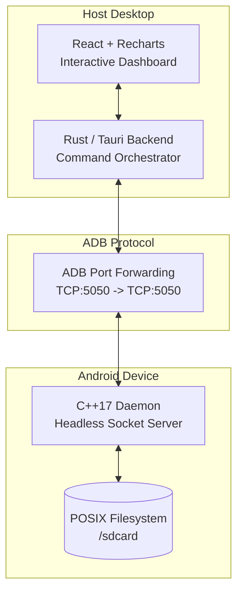
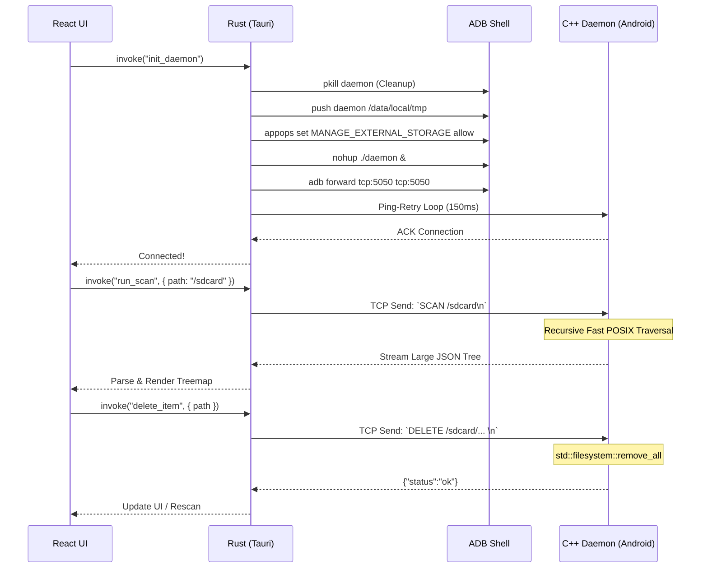

<div align="center">
  
  <h1>SocketSweep</h1>
  <p><strong>See what's eating your Android storage in seconds, not minutes.</strong></p>
  
  
  
  
  
  
  <br />
  <a href="https://github.com/sponsors/VishnuSrivatsava"></a>
</div>

<br />

<div align="center">
  <a href="https://youtu.be/ttsc6Xf6Xb4">
    
  </a>
  <br />
  <a href="https://youtu.be/ttsc6Xf6Xb4"><strong>▶ Watch the full demo and architecture breakdown</strong></a>
</div>

---

## 🔧 About this fork

This is a **modified version** of [SocketSweep](https://github.com/VishnuSrivatsava/SocketSweep) by Vishnu Srivatsava, released under the same **GPL-3.0** license — see [LICENSE](LICENSE). It started from upstream `main` at commit `bedcb60` (the v1.1.0 line) and also carries upstream's later fixes; the list below is what *this* fork changed.

The goal was to make it something you leave open while clearing a phone, not a demo you run once:

- **The whole interface in Chinese or English**, switchable in Settings and remembered on the machine — *including every backend failure*, which now travels to the front end as an error code and is worded there, so an English user never sees Chinese system text or the reverse.
- **A file list built for daily use**: four-column table, sortable, searchable, select-all, drag-to-paint selection that scrolls itself when you reach the edge, breadcrumbs, a per-row share tint (colour and on/off in Settings), and image previews dug out of each photo's own EXIF thumbnail.
- **Both directions**: upload by button or by dragging files in, move files inside the phone, and stop a running transfer — a stopped transfer leaves no half-written file on either side. Free space is checked on the PC *and* on the phone before any byte moves.
- **Wireless first**: QR pairing, a three-step fallback when the LAN search finds nothing, and one row per phone even when it is plugged in *and* paired over Wi-Fi.
- **Roughly three times faster over wireless adb.** The phone gzips its own answer (57 MB of repeated paths becomes 9 MB) and the Rust bridge stopped copying the payload three times. Measured on a Redmi K40, 250,000 files: **~74 s → 21–35 s**.
- **Failures are visible now.** A tunnel that drops mid-scan is reported instead of silently arriving short; commands that talk to the phone run off the UI thread; nothing opens a console window per adb call any more.
- The log panel prints the phone's own phase breakdown — traverse, sort, write, send, compressed size — so a slow scan says where the time actually went.

Deleting still asks first, and the cache of files you opened lives on the PC, separate from anything on the phone.

---

## 😤 The Problem

Ever plugged your Android phone into your PC to figure out what's eating all your storage?

Here's what happens with the standard USB connection (MTP):

- You open the phone in File Explorer / Finder
- Click on a folder with lots of files
- **"Calculating size..."** — hangs for 4+ minutes
- Eventually shows sizes, but navigating is painfully slow
- Trying to find large files? Good luck scrolling through hundreds of folders one by one

This is because **MTP (Media Transfer Protocol)** — the protocol your OS uses to talk to Android over USB — was designed in 2008 for MP3 players. It transfers file metadata one item at a time, with no caching, no parallel requests, and no way to do a fast recursive scan. It was never built for phones with 100GB+ of photos, videos, and apps.

**SocketSweep bypasses MTP entirely.**

---

## ⚡ How Fast?

Full `/sdcard` scan on a **Samsung Galaxy S24 Ultra (256GB)** with ~47,000 files:

> **SocketSweep: ~6-15 seconds** — full interactive treemap ready to explore.

Scan time varies depending on device load (background apps, media indexing, thermal state). Best case was 6.9 seconds with a warm cache and minimal background activity.

For comparison, doing the same thing over MTP (plugging in the phone and browsing via Windows Explorer or Finder) typically involves minutes of "Calculating size..." freezes, and macOS Finder doesn't even show folder sizes at all.

*Proper side-by-side benchmarks against OpenMTP and other tools are coming soon.*

---

## 📸 What It Looks Like

<div align="center">
  
  
  <br />
  <p><em>Left: Connection Dashboard | Right: Interactive Treemap — click any block to drill down</em></p>
</div>

---

## 🚀 How to Use

### 1. Download

This fork builds its packages with the same CI workflow, so they live in this repository's releases — [latest release](releases/latest):

| Platform | Download |
|----------|----------|
| 🪟 **Windows** | [Installer (.exe)](releases/latest) · [Enterprise (.msi)](releases/latest) |
| 🍎 **macOS** (Apple Silicon) | [Disk Image (.dmg)](releases/latest) |
| 🐧 **Linux** | [AppImage](releases/latest) · [.deb](releases/latest) |

The original project's [v1.1.1 packages are here](https://github.com/VishnuSrivatsava/SocketSweep/releases/tag/v1.1.1).

> **Windows note:** these builds are not code-signed, so SmartScreen may show *"Windows protected your PC"* — click *More info* → *Run anyway*.

> **Arch/AUR note:** The [`socketsweep-bin`](https://aur.archlinux.org/packages/socketsweep-bin) package is currently unmaintained and its checksum check fails until an adopter bumps it to v1.1.1. In the meantime, Arch users can install the .deb directly: `sudo pacman -U SocketSweep_1.1.1_amd64.deb`

> **macOS note:** Since the build is ad-hoc signed, run this once after installing:
> ```bash
> xattr -cr /Applications/SocketSweep.app
> ```

### 2. Enable USB Debugging on your phone
Go to **Settings → About Phone → tap "Build Number" 7 times** to unlock Developer Options. Then go to **Settings → Developer Options → enable "USB Debugging"**.

### 3. Plug in and scan
1. Connect your phone via USB cable
2. Open SocketSweep
3. Click **Connect** — the app will automatically push the daemon to your phone and set everything up
4. Click **Scan** — your full storage treemap loads in seconds
5. Click on any block in the treemap to drill down. Found something huge you don't need? Delete it right from the app.

That's it. No apps to install on your phone, no Wi-Fi setup, no root required.

---

## 🧠 How It Works (The Short Version)

Instead of going through MTP, SocketSweep does something completely different:

1. **Pushes a tiny C++ program** (~1MB) to your phone via ADB
2. **That program scans the filesystem directly** on the phone using native POSIX calls — this is why it's so fast (no MTP bottleneck)
3. **Streams the results back** to your PC over a TCP socket through the USB cable
4. **Renders an interactive treemap** in a React frontend so you can visually see what's taking space

The architecture was inspired by [scrcpy](https://github.com/Genymobile/scrcpy) — the "push a native binary via ADB, communicate over a local socket" pattern.

---

## 🏗 Architecture (For Developers)

SocketSweep has three layers:



### Interaction Lifecycle



---

## 🔧 Development Setup (Building from Source)

### Prerequisites
1. **Node.js** (v18+)
2. **Rust** (v1.70+ with Cargo)
3. **Android NDK** (v26d or newer)
4. **Android SDK / ADB** installed and added to your system `$PATH`.

### 1. Compile the C++ Daemon
Cross-compile the daemon for `aarch64-linux-android`:
```bash
# Set your NDK path
export NDK=/path/to/your/android-ndk-r26d

# Build the daemon
cd engine
bash ./build.sh
```
*This generates the stripped `daemon` binary in the `engine/` directory.*

### 2. Install Frontend Dependencies
```bash
cd ..
npm install
```

### 3. Run the App
```bash
npm run tauri dev
```
*Ensure your Android device is plugged in via USB and **USB Debugging** is enabled.*

### Fork build notes

Three things differ from the steps above when building this fork:

1. **The daemon needs zlib.** It gzips its own answer, so `engine/build.sh` links the NDK's static `libz.a` (falling back to `-lz`) and strips the binary. It also runs under Git Bash on Windows, not just Linux/macOS.
2. **Windows binaries are not in the repository.** `src-tauri/bin/adb.exe`, `AdbWinApi.dll`, `AdbWinUsbApi.dll` and `src-tauri/webview2/WebView2Loader.dll` are gitignored — copy the first three out of Google's platform-tools. The loader is needed because a GNU-toolchain build links it dynamically, so an installer without it dies at load time with `STATUS_DLL_NOT_FOUND`.
3. **Bundle on Windows with the overlay config**, which is what keeps the shared `tauri.conf.json` valid for Linux and macOS:
   ```bash
   npm run tauri build -- --bundles nsis --config src-tauri/tauri.windows-gnu.json
   ```
   `src-tauri/Cargo.toml` also pins `crate-type = ["rlib"]`: the mobile `cdylib`/`staticlib` targets make the Windows GNU linker emit an export table it cannot handle (*export ordinal too large*). An MSVC build does not need this.

---

## 🛠 Troubleshooting

### "0 Files" or Missing Folders on Android 11+
Android 11 introduced Scoped Storage, restricting file access. SocketSweep automatically tries to bypass this via:
```bash
adb shell appops set com.android.shell MANAGE_EXTERNAL_STORAGE allow
```
If scanning still shows nothing, check if your OEM requires extra toggles (e.g., Xiaomi needs "USB Debugging (Security settings)" enabled).

### Samsung Auto Blocker
If you're on a Samsung device and USB Debugging is greyed out, you probably have **Auto Blocker** enabled. Go to **Settings → Security → Auto Blocker** and turn it off. Auto Blocker disables USB Debugging entirely, so no ADB-based tool (including SocketSweep) will work with it on. It's off by default — you'd only have this issue if you manually turned it on.

### AppImage Fails to Launch on Arch Linux (Wayland)
If the AppImage crashes or fails to start on Arch Linux under a Wayland session, launch it with the Wayland client library preloaded:
```bash
LD_PRELOAD=/usr/lib/libwayland-client.so ./SocketSweep.AppImage
```
See [this issue](https://github.com/gitbutlerapp/gitbutler/issues/5282#issuecomment-3598600651) for more context.

### Daemon Fails to Start
If you get `Permission denied`, make sure the daemon is being pushed to `/data/local/tmp/`. Modern Android blocks execution from `/sdcard/`. SocketSweep handles this automatically.

---

## 💖 Support This Project

If SocketSweep saved you from the nightmare of MTP, consider supporting its development:

<div align="center">
  <a href="https://github.com/sponsors/VishnuSrivatsava"></a>
  &nbsp;&nbsp;
  <a href="https://paypal.me/mathcuber"></a>
</div>

---

## 📦 Third-party components

An installed copy carries more than this repository's source, and each piece keeps its own terms:

| Component | Licence | Where it ends up |
|---|---|---|
| `adb` (Android platform-tools, Google) | Apache-2.0 | next to the app; used to reach the phone |
| `WebView2Loader.dll` (Microsoft) | Microsoft WebView2 distribution terms | next to the executable in Windows builds |
| zlib, **statically linked into the phone daemon** | zlib licence (GPL-compatible) | inside `src-tauri/bin/daemon` |
| Inter, JetBrains Mono | SIL Open Font License 1.1 | embedded in the front end and served from the app rather than a CDN; the licence text is kept in [`licenses/`](licenses) |
| Tauri 2, React 19, Recharts | MIT / Apache-2.0 | the desktop shell and the UI |

The complete corresponding source for any build of this fork is this repository at the commit that build came from.

---

## 📄 License

SocketSweep is released under the **GNU General Public License v3.0**. See the [LICENSE](LICENSE) file for more details.

---

## 👋 Author

Built by **Vishnu Srivatsava**. Inspired by the architecture of [scrcpy](https://github.com/Genymobile/scrcpy). Currently looking for Backend / Systems Engineering roles. Feel free to reach out on [LinkedIn](https://www.linkedin.com/in/vishnu-srivatsava-642222238/) or via [email](mailto:vishnusrivatsava@gmail.com).
