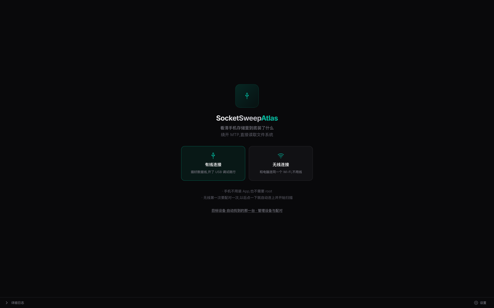
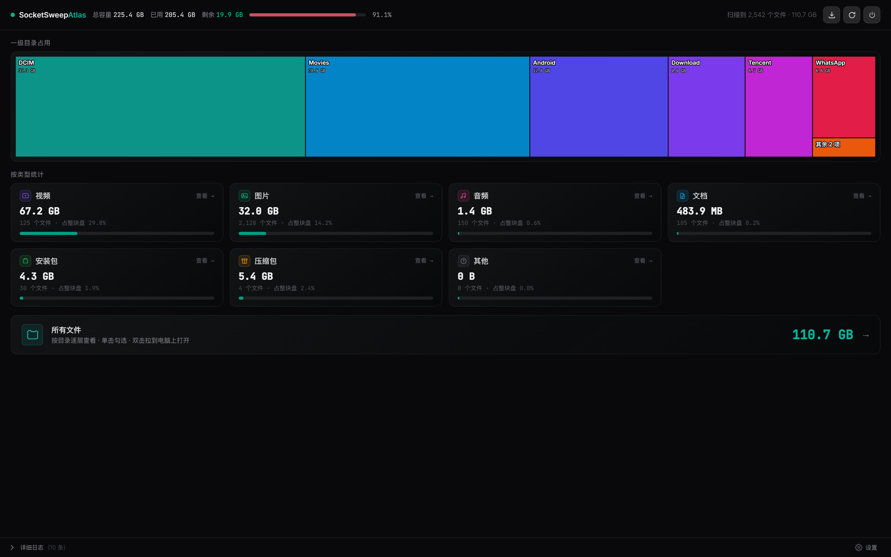
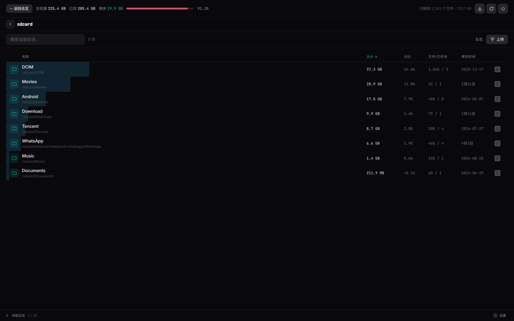
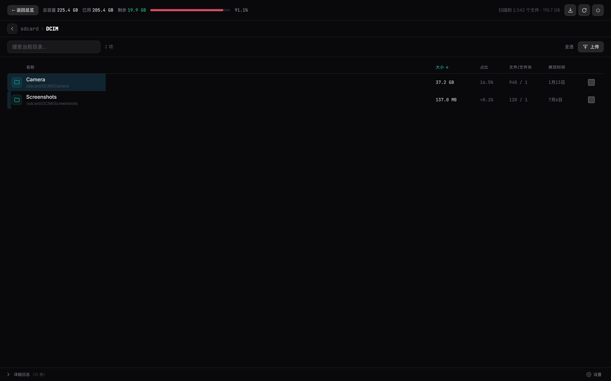
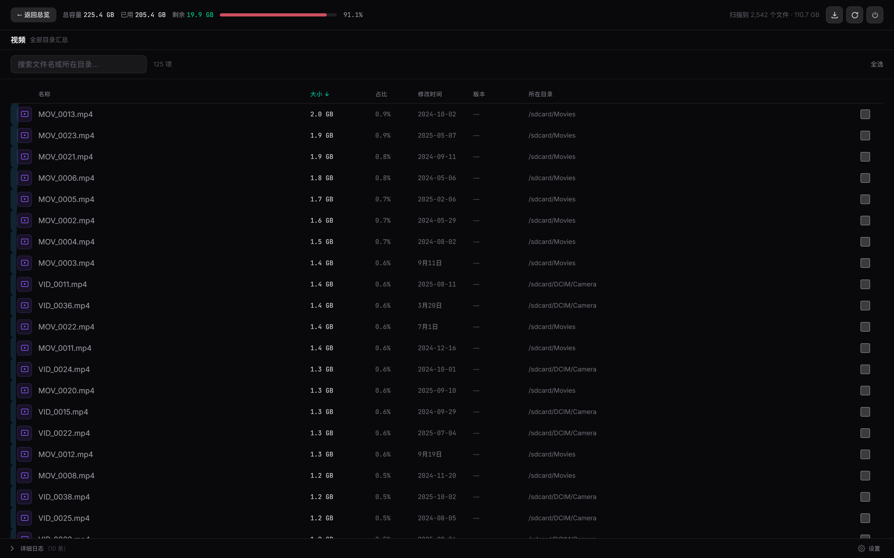
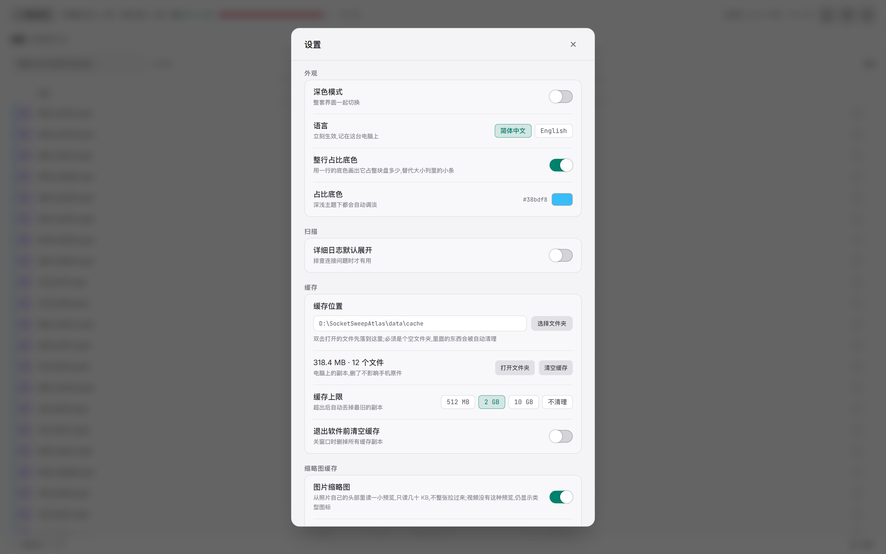

# SocketSweepAtlas

**几分钟看清手机存储到底被什么占满了 —— 走 USB 或无线，手机上什么都不用装。**

[English](README.md) · [技术设计文档](docs/DESIGN.zh-CN.md)

SocketSweepAtlas 是 [SocketSweep](https://github.com/VishnuSrivatsava/SocketSweep)（作者 [Vishnu Srivatsava](https://github.com/VishnuSrivatsava)）的维护分支，沿用原有的 **GPL-3.0** 授权，见 [LICENSE](LICENSE)。起点是上游 `main` 的 `bedcb60`，并已并入上游后来的安全改动。[本 fork 改了什么](#本-fork-改了什么)列在下面，每一条数字的测法都在技术设计文档里。

---

## 为什么要它

手机插电脑，打开文件夹，点进去——**"正在计算大小…"**，四分钟过去只算了一半，而且 MTP 每次都要一个文件一个文件地问，永远问不完。

SocketSweepAtlas 不走 MTP。它通过 `adb` 直接读手机的文件系统，四个线程并行遍历，压缩在手机上完成，整棵树在你电脑上拼装。手机上不装 App、不需要 root、不联网——除了跟手机说话，它不打开任何网络端口。

```
Redmi K40，25.8 万个文件，146 GB，无线 adb 全盘扫描：

  原版 SocketSweep ................... 约 74 秒
  + 回答压缩 ......................... 21–35 秒
  + 目录并行遍历 ..................... 6–10 秒   ← 本 fork
```

## 你会看到什么

**两种进法，手机都记得。** 数据线，或者扫二维码配对一次——之后点一下就自动连上并开始扫描。



**总览先回答你最关心的那个问题。** 一张一级目录方块图，同一次扫描里顺带把每种类型的数量和体积都统计好，不用再扫一遍才知道视频占多少。



**然后它就是一个文件管理器。** 每一列表头都能点着排序（体积、占整块盘的比例、名称、修改时间、以及文件所在的目录），当前目录内搜索，全选，按住拖动连选（拖到边缘会自动滚），整行底色直接告诉你这一项占了全盘多少。



**逐层进入，回来还在原地。** 面包屑、顶层也能用的返回箭头，以及每个目录各自的滚动位置都会记住。



**按类型看，安装包还带版本号。** 安装包视图会去读每个 APK 自己的清单，把 `versionName` 显示出来——不安装、不解压、不往手机写任何东西。



**你的电脑你说了算。** 深色/浅色，中文/英文（连手机返回的报错也一起翻译），预览和打开过的文件缓存默认放在软件自己旁边的文件夹里，不去挤 C 盘。



## 本 fork 改了什么

下面每一条都是在 Redmi K40、约 25.8 万个文件、无线 adb 上实测的；数字怎么来的见[技术设计文档](docs/DESIGN.zh-CN.md)。

- **手机上快约十倍，线路上快约三倍。** 手机自己把回答 gzip 压缩（57.5 MB 全是重复路径的文本压成 9.3 MB），并且把目录交给一小池读取线程处理，因为 `readdir`/`lstat` 是在等存储而不是在算 CPU：手机自报的遍历时间从约 24 秒降到 2.4–4.5 秒。
- **并行遍历用的是本 fork 自己的实现，这是有意为之。** 上游也做了并行遍历，它每领一个目录任务都要从被钉住的扫描根一层一层重新打开——扫描期间更安全，但在我这台手机上慢约四倍（13–18 秒对 3–5 秒，交替三轮，同一台手机同一份数据），而结果树一字不差。那层"边走边校验"的保护被留在了真正会丢数据的地方：删除路径。
- **整套界面中文或英文**，在设置里切换并记在电脑上——**包括手机返回的每一条失败**，后端只发错误码，措辞在前端字典里，所以不会出现语言对不上的系统原文。
- **一个适合天天用的文件列表**：每列都能排序、所在目录可点、图片预览直接从照片自己的 EXIF 里挖、APK 版本号读自包内清单、勾选过的行整行高亮、每个目录各自记住滚动位置。
- **双向传输。** 按钮上传或把文件拖进来，手机内部移动文件，正在传的任务可以取消——取消后电脑和手机两边都不留半截文件。动任何一个字节之前，电脑和手机的剩余空间都会先查一遍。
- **无线优先。** 扫码配对、局域网发现失灵时的三步兜底，以及"一台手机一行"（同时插线又配对过 Wi-Fi 也只算一台）。
- **失败看得见，而且多数能自己恢复。** 隧道中途断掉、回答一个字节都没回来、守护进程起来了却扫到 0 个文件——这三种情况都会被识别、报出来，并自动重启手机侧程序重扫一次。跟手机说话的命令全部不在界面线程上跑，每次 adb 调用也不再闪出黑窗口。
- **删得掉真实安卓结构里的东西，而且拒绝时会说明理由。** 安卓上 `/sdcard/Android/data` 自己就是一个文件系统，所以上游那条"不许跨文件系统"把每一个应用缓存目录都判成不能删——而那正是最值得删的一大片。现在删除会跟着这次扫描走，跨过它真正走过的挂载点，扫描没进去的照样拦住。被拒绝时报的是手机守的那条规则：文件已经不在了、正被占用、在你扫描的目录外面、属于另一个文件系统、是个快捷方式、嵌套太深——而不是一句含糊的"权限不足"。
- **临时文件放在软件旁边。** 预览与打开过的文件缓存默认落在安装目录下的文件夹，占用可查、可列、可分别清空，下载的东西永远不会被自动清理。
- **日志面板会打印手机自己报的分段耗时**——遍历、排序、写出、送隧道、压缩后体积——所以一次慢扫描能看出时间到底花在哪。

**安全性，这也是并入上游那批改动的主要原因：**

- 扫描全程只读。删除、移动、上传都要你先确认；扫过哪个目录就被钉住哪个目录，外面的东西删不掉，扫描根目录本身永远删不掉。
- 每次连接手机都带一把一次性的随机会话密钥。没带密钥、或者密钥不对的命令，在还没被解析之前就被拒绝；手机上的密钥文件权限是 `0600`，程序一起来就把它删掉了。
- 删除是逐级 `openat` 解析的，每一层都带 `O_NOFOLLOW` 和身份比对，所以中途被换掉的路径不可能被跟着走下去。
- 如果手机的 adb shell 恰好是 root，程序会自动进入只读模式，拒绝一切删除。

## 开始使用

**需要准备：** 一台电脑、一根数据线或同一个 Wi-Fi，以及 [Android platform-tools](https://developer.android.com/tools/releases/platform-tools)（Windows 版把 `adb` 打进了应用里；Linux/macOS 请自行安装或让应用去找）。Android 11 及以上可用；手机要开 USB 调试，无线还要在*开发者选项 → 无线调试*里扫一次配对二维码。

1. 到 [Releases](releases/latest) 下载 `SocketSweepAtlas_1.3.0_*`：Windows `.exe`（NSIS）、Linux `.deb` / `.AppImage`、macOS `.dmg`。
2. 手机上打开 USB 调试（设置 → 我的设备 → 全部参数 → 连点"版本号"七次 → 开发者选项）。
3. 插上线，在手机上允许调试授权，然后点**扫描**。或者选**无线**，扫一次配对码——之后它自己会连上。

三星：锁屏会掐掉 adb，请保持屏幕常亮。小米/红米 MIUI：第一次配对时请把*无线调试*这个页面开着别退出——有些系统只在这个界面可见时才对外广播。

## 从源码构建

```bash
npm ci
npm test                                          # 前端工具函数
NDK=/path/to/android-ndk bash engine/build.sh     # 手机侧程序（aarch64，静态链接 zlib）
npm run tauri dev                                 # 连真机跑
npm run tauri build                               # 打包
```

三条本 fork 特有的注意：`engine/build.sh` 和 CI 里两处守护进程编译都要链接 zlib（因为手机侧自己压缩回答）；`adb.exe`、`AdbWinApi.dll`、`AdbWinUsbApi.dll` 被 gitignore 排除了：CI 会从 Google 下载 platform-tools，本地构建则要手工放进去；`WebView2Loader.dll` 只有用 **GNU** 工具链打包时才需要放在可执行文件旁边，因为 `webview2-com-sys` 在 MSVC 上静态链接 `WebView2LoaderStatic`；用 GNU 工具链在 Windows 上打包必须加 `--config src-tauri/tauri.windows-gnu.json`，并且 `src-tauri/Cargo.toml` 里要保留 `crate-type = ["rlib"]`。在 Windows/GNU 上，`cargo test --lib` 和那套 Python 守护进程测试本机跑不了，由 CI 执行。

值得知道的三层测试：`npm test` 管字节数格式化；`cargo test --lib` 管发给手机的命令封包，以及 Rust 与 C++ 两边协议版本号必须一致；`python3 -m unittest discover -s tests` 直接测守护进程（鉴权、扫描根保护、删除竞态、"一个线程 vs 四个线程结果必须相同"）——只能在 Linux/macOS 上跑。

## 常见问题

| 现象 | 实际原因 |
|---|---|
| **0 个文件，或者 Android 11+ 少了一些目录** | 本程序通过 adb 读 `/sdcard`，和 MediaStore 不是同一个视图。重扫一次；如果某个目录确实被分区存储挡住，它就是不会出现在列表里。 |
| **三星上"扫描一直不开始"** | 手机锁屏或开了*防止 USB 调试*类选项时会掐掉 adb。保持屏幕常亮，并在开发者选项里关掉相关限制。 |
| **无线配对超时** | 手机要和电脑在同一个 Wi-Fi，并且配对过程中*无线调试*对话框必须一直开着。 |
| **扫描比上面的数字慢很多** | 看日志面板那行分段计时。如果"送隧道"占大头，就是线路带宽到顶了（无线 adb 实测约 2.4 MB/s）；如果"遍历"占大头，说明手机是冷缓存或者正在忙着写文件。 |

## 第三方组件

一份安装包里除了本仓库的源码，还带着这些东西，各自保留自己的授权：

| 组件 | 授权 | 落在哪里 |
|---|---|---|
| adb（Android platform-tools，Google） | Apache-2.0 | 与程序同目录，用来连接手机 |
| `WebView2Loader.dll`（Microsoft） | Microsoft WebView2 分发条款 | 只出现在 **GNU** 工具链的 Windows 版里，与可执行文件同目录；MSVC 版静态链接的是 loader 的静态库 |
| zlib，**静态链接进手机侧程序** | zlib 授权（与 GPL 兼容） | 在 `src-tauri/bin/daemon` 里面 |
| Inter、JetBrains Mono | SIL Open Font License 1.1 | 内嵌在前端、由程序自己提供而不是走 CDN，授权原文在 [`licenses/`](licenses) |
| Tauri 2、React 19、Recharts | MIT / Apache-2.0 | 桌面外壳与界面 |

## 出处与授权

SocketSweep 这个名字、这个思路、以及手机侧那套做法，都是 [Vishnu Srivatsava](https://github.com/VishnuSrivatsava) 的作品；他公开表示欢迎分支和 PR。整体架构受 [scrcpy](https://github.com/Genymobile/scrcpy) 启发。

本 fork 与原项目一样使用 **GNU General Public License v3.0**，见 [LICENSE](LICENSE)。任何一份构建的完整对应源码就是本仓库对应那个提交，提交历史即"改动了什么"的说明。
